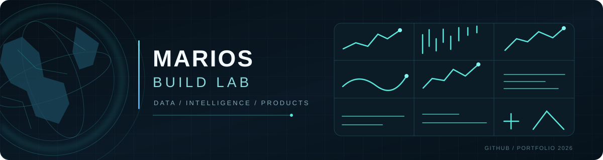
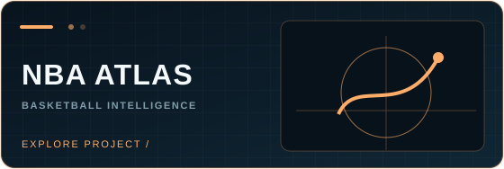
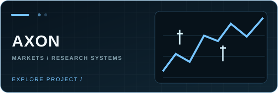
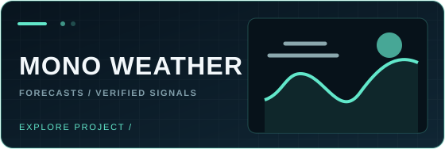
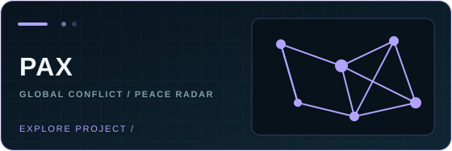
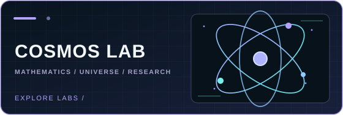
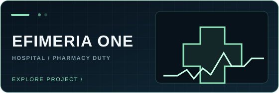
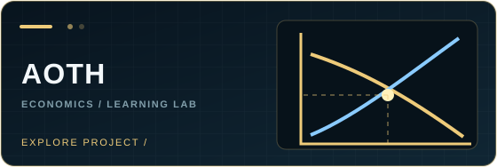

<!-- Profile README template. The public profile repository is mariodinakus/mariodinakus; keep it in sync with this file. -->

  

<h1 align="center">Marios Dinakus</h1>

  <strong>Building data-rich digital products, analytical tools and independent monitoring systems.</strong>

  <a href="https://github.com/mariodinakus?tab=repositories">Repositories</a>
  ·
  <a href="https://github.com/mariodinakus/sideline-sports">NBA Atlas</a>
  ·
  <a href="https://github.com/mariodinakus/monokairos">MONO Weather</a>
  ·
  <a href="https://github.com/mariodinakus/cosmos-lab">COSMOS LAB</a>

---

### Core projects

<table>
<tr>
<td width="50%" valign="top">
  
  
Live basketball information, historical records, advanced statistics and predictive analysis.

  <a href="https://github.com/mariodinakus/sideline-sports"><b>View repository</b></a>
</td>
<td width="50%" valign="top">
  
  
Markets, financial intelligence and research tools. <b>Private development.</b>

  
<i>Repository access is restricted.</i>

</td>
</tr>
<tr>
<td width="50%" valign="top">
  
  
Weather forecasts, observed station verification, forecast confidence and mobile-first experiences.

  <a href="https://github.com/mariodinakus/monokairos"><b>View repository</b></a>
</td>
<td width="50%" valign="top">
  
  
Evidence-oriented conflict and peace monitoring, geopolitical timelines and risk signals.

  <a href="https://github.com/mariodinakus/world-faultline/tree/main/pax"><b>Explore PAX module</b></a>
</td>
</tr>
<tr>
<td colspan="2" valign="top" align="center">
  
  
<strong>COSMOS LAB — The Mathematical Universe</strong>

  
Interactive physics and mathematics labs, adjustable toy models, foundational questions and source-linked research papers with cautious summaries.

  
<a href="https://github.com/mariodinakus/cosmos-lab"><b>View repository</b></a> · <a href="https://cosmos-lab-v3.vercel.app/radar.html"><b>Research Radar</b></a>

</td>
</tr>
</table>

### Active products

<table>
<tr>
<td width="50%" valign="top">
  
  
Published hospital and pharmacy duty schedules, with visible source and date limitations.

  <a href="https://github.com/mariodinakus/efimeria-one"><b>View repository</b></a>
</td>
<td width="50%" valign="top">
  
  
Greek high-school economics resources, interactive exercises and self-assessment labs.

  <a href="https://github.com/mariodinakus/aoth"><b>View repository</b></a>
</td>
</tr>
</table>

---

### How I build

- **Data before decoration:** source links, timestamps and limitations when data are incomplete.
- **From research to usable apps:** real-world dashboards, forecasts, interactive teaching and evidence-first tooling.
- **Privacy and maintainability:** secrets stay out of Git; reviews and CI protect production code.
- **Focused development:** five core products, two active supporting products; experiments are reviewed before expansion.

Built with curiosity. Maintained with evidence.

